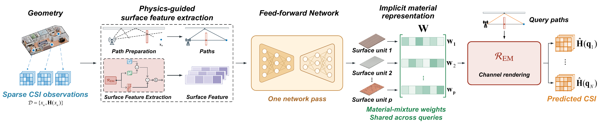
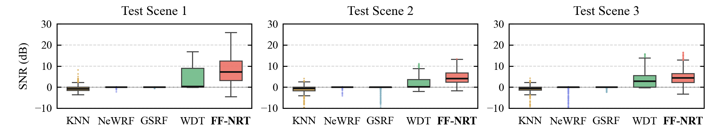
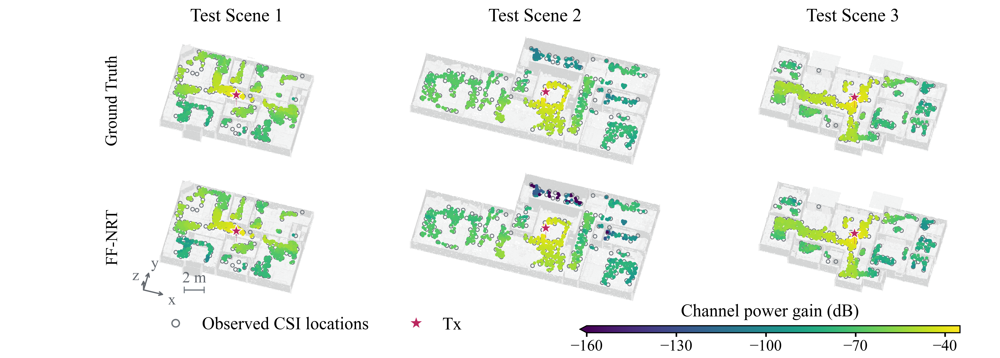
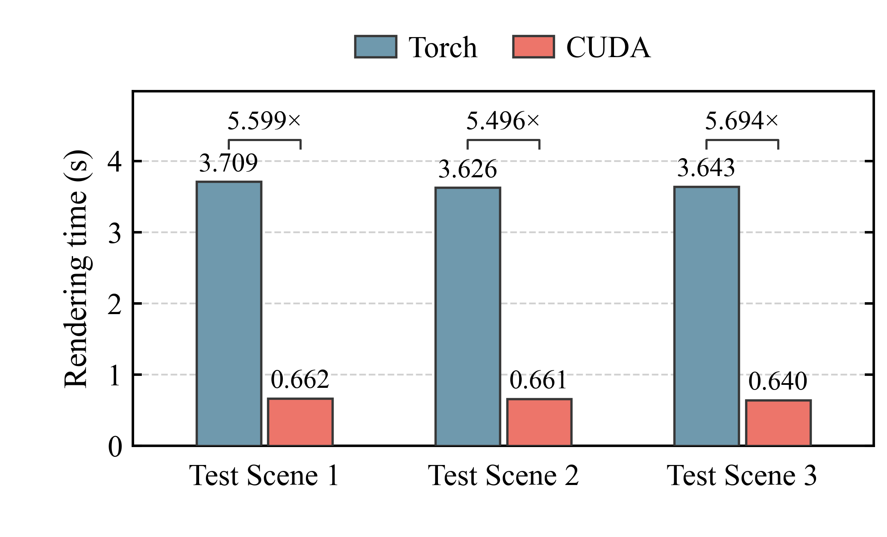
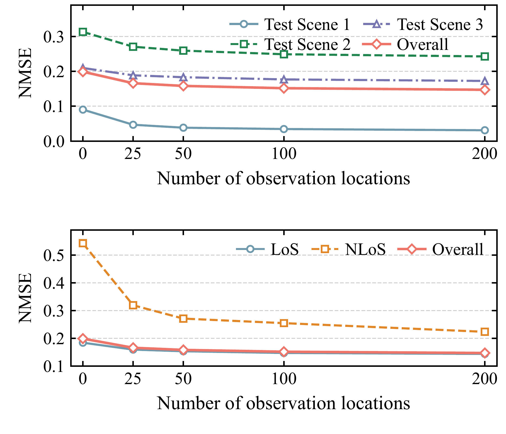

# FF-NRT: Feed-Forward Neural Ray Tracing for Generalizable Wireless Channel Prediction

FF-NRT predicts complex MIMO CSI from known scene geometry and sparse CSI observations. A shared network infers effective surface responses in one pass; a physical renderer reuses them at unmeasured locations without scene-specific parameter optimization.

## Results

CSI is simulated with Sionna RT in 18 HSSD indoor scenes: 15 for training and 3 held out from training.

### CSI prediction accuracy

Median CSI reconstruction SNR improves by **6.98, 3.83, and 1.59 dB** over the strongest evaluated baseline in Test Scenes 1–3.

### Spatial channel power

Ground-truth and predicted channel power gain at all 800 target locations per scene.

### CUDA renderer efficiency

The CUDA renderer achieves **5.50–5.69×** median paired forward speedup over Torch on an RTX 4090 with identical prepared inputs. Timing excludes path search and physical preparation.

### Ablation on the number of observation locations

Increasing observations from 0 to 200 reduces aggregate NMSE from **0.1988 to 0.1471**. K=0 uses the frozen prior directly; positive K uses the fixed network with nested observation subsets.

## Code

Result figures are currently available. Research code is planned for release following paper acceptance.

## Acknowledgments

Scenes: [HSSD](https://3dlg-hcvc.github.io/hssd/). Channel simulations: [Sionna RT](https://arxiv.org/abs/2504.21719v2).
